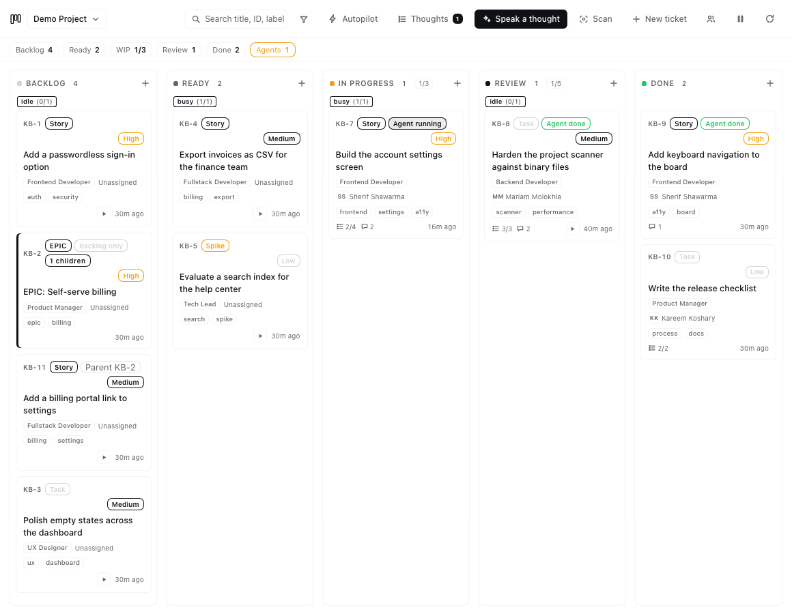
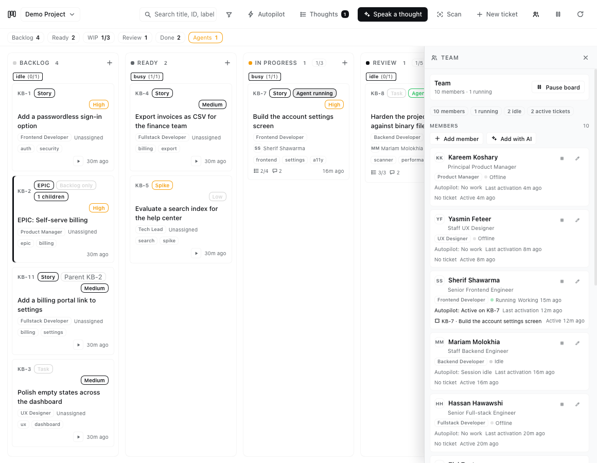
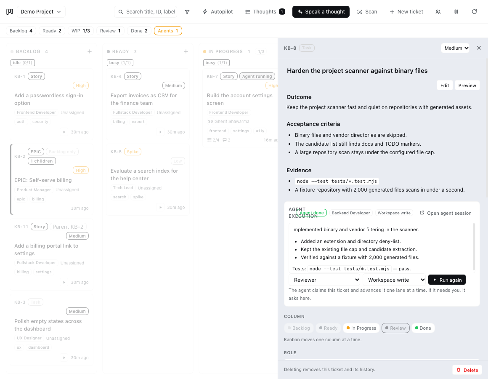
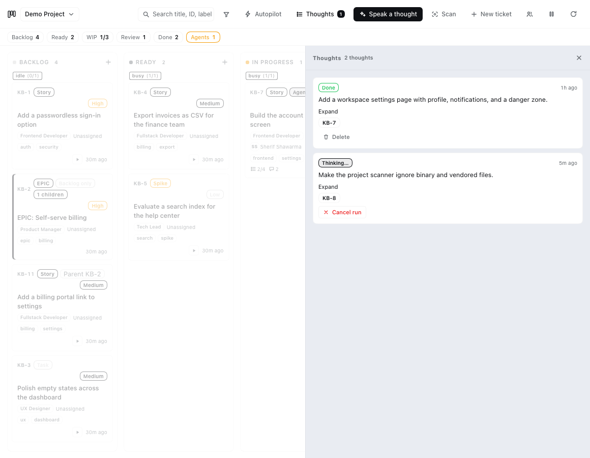
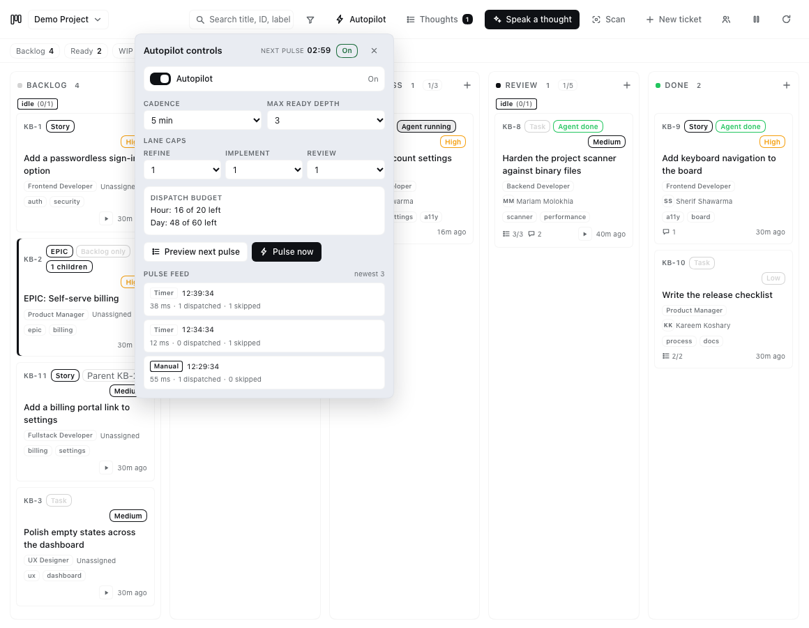
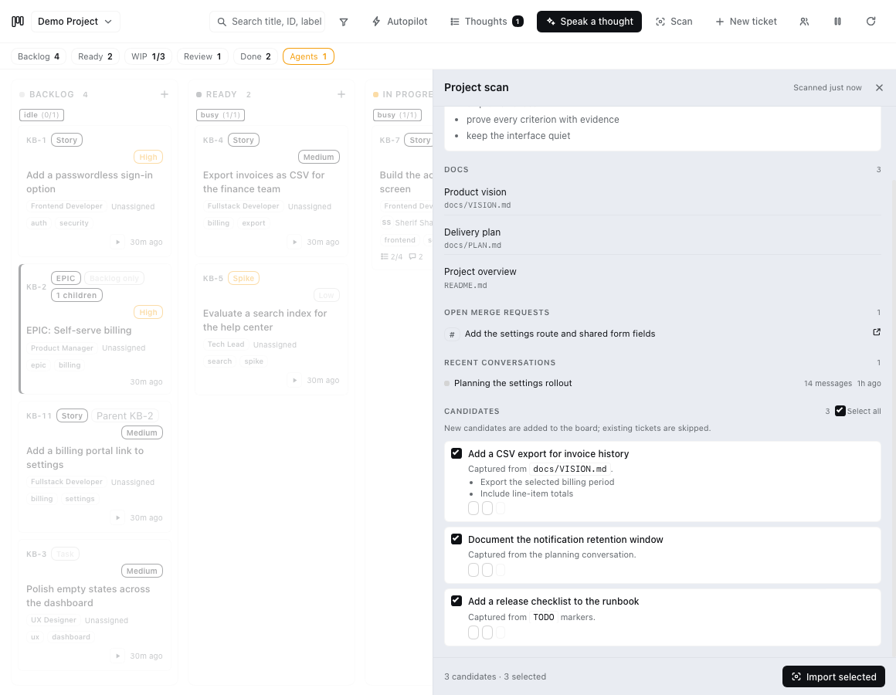

# Kanban for DeepSeek Harness

**One board. One workflow. Every agent.**

A project-scoped Kanban board for **DeepSeek Harness** that gives every agent in a workspace one
shared, role-aware way to move work.

Humans see the queue. Agents pull from it. The plugin enforces the rules.



*A demo board: a running ticket, an EPIC, a review gate, and the team rail entry point.*

- One board per workspace, backed by local JSON — no external service, no database, no sync.
- A visual board for people, and a `kanban` tool plus workflow skill for agents.
- Dependency-free: plain Node.js, no build step, no npm install.

## Highlights

- **A real board.** Backlog → Ready → In Progress → Review → Done, with drag-and-drop, search, filters,
  light/dark themes, and English/Chinese UI.
- **Policy, enforced.** One lane at a time, WIP limits, one in-flight ticket per agent, role-owned
  claims, a reviewer gate, Definitions of Ready/Done, blocked visibility, and pause.
- **Thoughts become tickets.** Capture one sentence; a read-only product-manager agent refines it into
  Backlog tickets and opens an EPIC with a PRD when the work needs more than one ticket.
- **A named team.** Ten seeded specialists, one per role, with editable personas, live status,
  current ticket, and per-member pause/resume. Add teammates manually or with AI.
- **Ticket-scoped agents.** Dispatch a dedicated DSH session with the project preset, an access mode,
  and a complete ticket brief. Watch it work, answer its questions, and read its report.
- **Optional autopilot.** A bounded, budgeted pull loop for refine, implement, and review — off by
  default, with a dry-run preview and a pulse feed.
- **Adopt existing work.** Scan a project's docs, TODOs, recent sessions, and open PRs/MRs, then import
  only the candidates you choose.
- **Local-first.** Boards, rosters, thoughts, and pulse history stay on your machine.

## Requirements

- A DeepSeek Harness installation with bundle support.
- Node.js 20 or newer (the version bundled with DSH is fine).
- Optional: authenticated `gh` or `glab` for GitHub PR / GitLab MR discovery during a scan.

## Install

Install the checkout as a local DSH bundle. Ask DeepSeek Harness to run:

```text
plugin_manager install_bundle target=/absolute/path/to/dsh-kanban
```

Or link the package from your profile's `package.json`:

```json
"dependencies": {
  "@local/dsh-kanban": "link:/absolute/path/to/dsh-kanban"
}
```

Refresh the Web GUI once. A **Kanban** icon appears in the sidebar.

The bundle patch registers the plugin with these defaults:

```yaml
- insert:
    - id: kanban
      name: '@local/dsh-kanban'
      config:
        wipInProgress: 3
        wipReview: 5
        scanMaxFiles: 160
```

## Quick start

1. Open **Kanban** from the sidebar and select a workspace.
2. Press **Scan** to adopt an existing project, or **+ New ticket** to start manually.
3. Or press **Speak a thought**, say or type one sentence, and let the product-manager agent break it
   into tickets.
4. Drag tickets across lanes. Open a ticket to edit its brief, assign an owner, and start an agent.
5. Open **Team** for the roster, roles, personas, and live status. Enable **Autopilot** only when you
   want the board to pull work on its own.

## How it works

### The board

| Lane | Purpose | Who moves it |
|---|---|---|
| **Backlog** | Captured work; not ready to pull | Product manager / tech lead refine → Ready |
| **Ready** | Refined, unambiguous, pullable | An implementation role claims → In Progress |
| **In Progress** | One owner is working it | Owner hands off → Review, or releases → Ready |
| **Review** | The change gate | Reviewer / tester / tech lead accept → Done, or request changes → In Progress |
| **Done** | Accepted against the Definition of Done | Tester / tech lead may reopen → Review |

A blocked ticket keeps its real lane and appears in a Blocked view until its questions are answered or
its permissions are granted.

### The rules

- Move one column at a time; skipping is rejected.
- WIP limits default to **3 In Progress / 5 Review** and are configurable.
- Each agent may hold only one in-flight ticket.
- Agents claim only from the lanes their role owns.
- Only a reviewer, tester, or tech lead can accept `Review → Done`.
- A paused board rejects agent mutations and stops running turns.
- Agents start with `kanban whoami`, then `kanban next`, claim work, and finish with a report.

### Roles and team

Ten roles ship with the plugin: product manager, UX designer, frontend, backend, full-stack, bug
fixer, reviewer, tester, SRE, and tech lead. Each has a numbered playbook, gates, escalation rules,
and a Definition of Done. A team member inherits exactly one role and adds an editable persona.
Dispatch composes **role playbook → persona → ticket context**; a persona changes how a person works,
never what the role is allowed to do.



*The team rail: roles, personas, current ticket, and live status.*

### Ticket execution

**Run with agent** creates a real DSH session in the project, mounts the project's agent preset, and
starts it with the ticket, role, lane, checklist, comments, source, and the chosen access mode — read
only, workspace write, full access, or auto. The card shows live state, and **Open agent session**
jumps to the conversation. Agents can `block` with questions or permission needs; **Send answers &
resume** continues the same session. On completion the report is stored on the ticket.

When a ticket changes lanes, the board suggests the next role and carries the handoff reason plus the
previous report, so the next agent inherits what happened.



*A ticket brief and its execution report in one drawer.*

### Thoughts and EPICs

The primary entry point is a thought. A read-only product-manager agent decomposes it into Backlog
tickets. Multi-ticket work becomes one EPIC with a filled PRD and linked children; a small thought
becomes tickets only. Intake has duplicate and rate-limit guardrails, an audit trail, and queued
capture while the board is paused.



*One thought creates a ticket; another is still with the product-manager agent.*

### Autopilot

Autopilot is off by default and uses no model tokens while idle. When enabled, a host-side timer runs
one planning pulse per cadence (5 minutes by default) and starts at most one session across three lane
groups: **refine** Backlog, **implement** Ready work, and **review** the Review gate. Lane caps, a
maximum Ready depth, hourly and daily dispatch budgets, backoff, a stale-run watchdog, and a loop
guard bound the work. Phase 1 runs one implementer and one reviewer at a time. Manual Start is always
available and never blocked by autopilot.



*Autopilot controls, dispatch budget, and the pulse feed.*

### Project scan

Scan an existing project for docs, TODO markers, recent sessions, and open PRs/MRs. Review the
candidates, then import only the ones you want.



*Project scan: vision, docs, merge requests, conversations, and selectable candidates.*

## Configuration

| Key | Default | Purpose |
|---|---|---|
| `wipInProgress` | `3` | Maximum tickets in In Progress |
| `wipReview` | `5` | Maximum tickets in Review |
| `scanMaxFiles` | `160` | Maximum files read during a project scan |
| `stateDir` | `$DSH_HOME/kanban` | Board and thought storage root |

Autopilot cadence, lane caps, and budgets are available in the Autopilot controls in the board header.

## Data and privacy

- Boards are stored per workspace as atomic JSON under `$DSH_HOME/kanban`.
- Thoughts and their audit history live under the same root.
- The board is local to the machine and has no telemetry, cloud sync, or external database.
- A scan can read local docs and, when `gh` or `glab` is installed, query PR/MR metadata.
- Agent access can be limited per dispatch with the access-mode picker.

## Development

Run the dependency-free test suite:

```bash
node --test tests/*.test.mjs
```

The `tools/` directory contains optional Chrome DevTools Protocol probes for driving the real Web GUI
and capturing evidence. They require a running GUI and a Chrome instance on the CDP port documented in
`tools/README.md`.

### Repository layout

| Path | Role |
|---|---|
| `index.js` | Host plugin: board store, HTTP routes, `kanban` tool, dispatch, scan, autopilot |
| `client.js` | Web panel: board, drawers, team rail, scan, autopilot UI |
| `roles.js` | Role catalog, policy tables, personas, playbooks, generated workflow skill |
| `locale/` | English and Chinese UI strings |
| `tests/` | Node test suites for the host, client, roles, execution, thoughts, and autopilot |
| `tools/` | CDP probes and development helpers |
| `cordis.patch.yml` | Bundle registration patch |
| `icon.svg` | Plugin artwork |

## Contributing

Issues and focused pull requests are welcome. Keep the plugin dependency-free, follow the existing
test style, and run `node --test tests/*.test.mjs` before opening a PR.

## License

No license has been declared yet. Until one is added, all rights are reserved.
